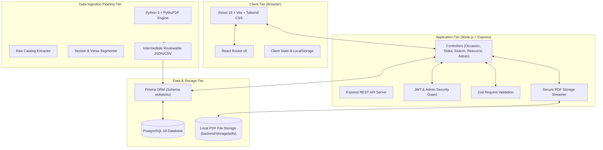

# SlokaSetu: System Architecture & Design Specification

## 1. System Overview

SlokaSetu is a multilingual digital platform connecting Hindu festival dates, Amrita institutional occasions, canonical slokas, their meanings, textual script variants, and downloadable PDF prayer resources.

The system is designed with strict separation of concerns, transactional consistency, normalized relational storage, and rigorous content verification.

## 2. Component Responsibilities

### 2.1 Client Tier (React + TypeScript + Vite)
- **Responsive Layout:** Warm ivory background (`#FDFCF7`), deep maroon accents (`#800020`), restrained gold highlights (`#D4AF37`).
- **Interactive Calendar:** Monthly view with Drik Ganita and institutional observance markers, regional filters, and day-selection side drawer.
- **Multilingual Text Reader:** Language and script selector, continuous vs verse-by-verse view toggle, font scaling, and 1-click clipboard copy.
- **Global Search:** Fast debounced live search querying canonical titles, aliases, and festival descriptions.
- **Preparation Checklist:** Interactive local progress tracker with non-dogmatic devotional guidance.
- **Administrative Portal:** Protected management interface for approving draft reviews, registering occasions/slokas, and monitoring audit logs.

### 2.2 Application Tier (Express + TypeScript)
- **RESTful Endpoints:** Validated JSON interfaces adhering to HTTP status standards.
- **Relational Access:** High-performance Prisma client configured with dedicated schema isolation (`slokasetu`).
- **Security & Authorization:** Role-based access control (Admin, Reviewer, Viewer), bcrypt password hashing, JWT bearer verification.
- **Resource Streaming:** Path-traversal protected streaming of binary PDF files with Content-Disposition headers and counter tracking.

### 2.3 Database Tier (PostgreSQL 18)
- **Normalization (3NF / BCNF):** Decoupled canonical devotional entities from textual versions and recurring festivals from year-specific dates.
- **Integrity Constraints:** Foreign keys with deliberate cascading behavior, unique slugs, NOT NULL constraints, and search indexes.
- **Relational Views:** Pre-compiled SQL views for liturgical overviews and multilingual availability matrices.

### 2.4 Data Pipeline Tier (Python + PyMuPDF)
- **Programmatic Extraction:** Direct extraction of document metadata, page boundaries, line structures, and headings.
- **Verse Segmentation:** Pattern matching for Sanskrit / Telugu / Tamil verse terminators (`॥ 1 ॥`).
- **Intermediate Cataloguing:** Generating structured JSON and CSV validation reports before database seeding.
