# SlokaSetu: Data Ingestion Pipeline & Verification Specification

## 1. Overview of the Ingestion Pipeline

The SlokaSetu data ingestion pipeline processes raw archival PDF documents, extracts text blocks, identifies sloka boundaries, maps multilingual scripts, generates intermediate reviewed datasets, and idempotently imports data into PostgreSQL.

```mermaid
flowchart LR
    PDF["Archival PDFs (4 documents)"]
    PyExtract["PyMuPDF Python Extraction"]
    Segment["Section & Verse Segmentation"]
    Match["Canonical Sloka Matching"]
    Export["Intermediate JSON / CSV Datasets"]
    Review["Human Review & Validation Report"]
    Seed["Prisma Database Seeder"]
    DB[("PostgreSQL 18 Database")]

    PDF --> PyExtract
    PyExtract --> Segment
    Segment --> Match
    Match --> Export
    Export --> Review
    Review --> Seed
    Seed --> DB
```

## 2. Ingested Archival Documents

| Document Filename | Language | Script | Extracted Pages | Canonical Content Extracted |
|---|---|---|---|---|
| `SRI MAHAGANAPATHI HOMAM JULY.pdf` | English / Sanskrit | Latin | 2 Pages | Official Programme of Sri Mahaganapathi Homam – 22 July 2026, Chennai Campus (15 Parayanam texts) |
| `ENGLISH.pdf` | Sanskrit | Latin (IAST) | 46 Pages | 27 Canonical Slokas (Amma Dhyanam, Ganesha Dhyanam, Ganesha Pancharatnam, Gurvashtakam, Lingashtakam, Shiva Tandava, Sudarshana Ashtakam, Govinda Namavali, Mahalakshmi Ashtakam) |
| `TELUGU.pdf` | Sanskrit | Telugu | 57 Pages | 27 Classical Sanskrit stotras in authentic Telugu script |
| `TAMIL.pdf` | Sanskrit | Tamil | 46 Pages | 27 Classical Sanskrit stotras in authentic Tamil script with Grantha notation |

## 3. Data Pipeline Implementation

- **Extraction Engine (`scripts/catalog_extractor.py`):** Uses PyMuPDF (`pymupdf`) to parse font structures, line arrays, and page boundaries into `data/extracted/raw_catalog.json`.
- **Normalization Pipeline (`scripts/ingestion_pipeline.py`):**
  - Identifies sloka boundaries using heading detection algorithms and verse terminators (`॥ 1 ॥`).
  - Matches cross-script versions using canonical slugs.
  - Computes confidence indicators (0.98–1.0 for verified direct matches).
  - Emits reviewable datasets:
    - `data/intermediate/slokas_catalog.json`
    - `data/intermediate/versions_catalog.json`
    - `data/intermediate/occasions_catalog.json`
    - `data/intermediate/extraction_validation_report.json`
    - `data/intermediate/adm_catalog_summary.csv`
- **Seeding & Idempotency (`backend/prisma/seed.ts`):** Uses Prisma upsert operations on unique constraints (`slug`, `code`, `fileName`, composite junction keys) to ensure that repeated executions do not generate duplicate records.
