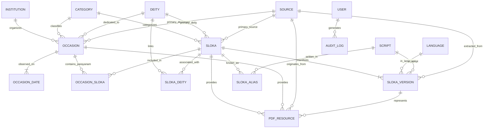

# SlokaSetu: Database Architecture & ADM Demonstration

## 1. Entity-Relationship (ER) Diagram



## 2. Normalization Justification

The database schema is designed according to Third Normal Form (3NF) and Boyce-Codd Normal Form (BCNF):

1. **Elimination of Transitive Dependencies:**
   - Sloka canonical identities are separated from their multilingual versions (`slokas` vs `sloka_versions`). A sloka has one canonical identity and multiple textual renderings (Sanskrit in Roman IAST, Sanskrit in Telugu script, Sanskrit in Tamil script).
   - Languages (`languages`) and Scripts (`scripts`) are separate relations. A Sanskrit language text rendered in Telugu script has `language_id = 'sa'` and `script_id = 'Telu'`.

2. **Decoupling Temporal Observance from Occasion Identity:**
   - Occasions (`occasions`) store invariant metadata (e.g., "Maha Shivaratri", spiritual significance, description).
   - Year-specific dates (`occasion_dates`) store Gregorian dates, calendar conventions (Drik Ganita, Purnimanta), and regional variants. This prevents anomalous date updates when displaying recurring festivals across different years.

3. **Many-to-Many Decoupling via Junction Tables:**
   - `occasion_slokas` links occasions to slokas with explicit relationship types (`OFFICIAL_PROGRAMME`, `TRADITIONAL`, `CURATED_RECOMMENDATION`) and liturgical display sequence.
   - `sloka_deities` allows a sloka to be reverently linked to multiple divine forms while designating a primary deity.

4. **Referential Integrity & Cascading Decisions:**
   - Deleting a canonical sloka cascades to its aliases and versions to prevent dangling textual records.
   - Deleting an occasion cascades to its specific dates.
   - Deleting a source sets resource references to `NULL` to preserve resource records without data loss.

---

## 3. The 12 ADM Demonstration SQL Queries

The following queries demonstrate relational DBMS capabilities including multi-table joins, cross-dimensional aggregations, correlated subqueries, set operations, and views.

### Query 1: Slokas Associated with an Occasion (Chennai Homam Parayanam)
```sql
SELECT 
    o.name AS occasion_name,
    os."displayOrder",
    os."relationshipType",
    s."canonicalTitle" AS sloka_title,
    c.name AS sloka_category,
    d.name AS deity_name,
    os.notes AS liturgical_notes
FROM occasions o
JOIN occasion_slokas os ON o.id = os."occasionId"
JOIN slokas s ON os."slokaId" = s.id
JOIN categories c ON s."categoryId" = c.id
LEFT JOIN deities d ON s."deityId" = d.id
WHERE o.slug = 'amrita-sri-mahaganapathi-homam-2026'
ORDER BY os."displayOrder" ASC;
```

### Query 2: Available Versions for a Sloka
```sql
SELECT 
    s."canonicalTitle",
    l.name AS language,
    sc.name AS script,
    v."versionType",
    v."pageStart",
    v."pageEnd",
    v."confidenceScore"
FROM slokas s
JOIN sloka_versions v ON s.id = v."slokaId"
JOIN languages l ON v."languageId" = l.id
JOIN scripts sc ON v."scriptId" = sc.id
WHERE s.slug = 'maha-ganesha-pancharatnam'
ORDER BY l.name ASC, sc.name ASC;
```

### Query 3: Slokas Available in Tamil Script
```sql
SELECT 
    s."canonicalTitle",
    s.slug,
    c.name AS category,
    v."versionType",
    src."fileName" AS source_document
FROM slokas s
JOIN sloka_versions v ON s.id = v."slokaId"
JOIN scripts sc ON v."scriptId" = sc.id
JOIN categories c ON s."categoryId" = c.id
LEFT JOIN sources src ON v."sourceId" = src.id
WHERE sc.code = 'Taml' AND v."isPublished" = true
ORDER BY s."canonicalTitle" ASC;
```

### Query 4: Occasions within a Selected Date Range
```sql
SELECT 
    o.name AS occasion_name,
    c.name AS category,
    od."gregorianDate",
    od.year,
    od.region
FROM occasions o
JOIN categories c ON o."categoryId" = c.id
JOIN occasion_dates od ON o.id = od."occasionId"
WHERE od."gregorianDate" >= '2026-07-01' 
  AND od."gregorianDate" <= '2026-10-31'
ORDER BY od."gregorianDate" ASC;
```

### Query 5: Sloka Distribution by Category
```sql
SELECT 
    c.name AS category_name,
    COUNT(s.id) AS total_slokas,
    ROUND(COUNT(s.id) * 100.0 / (SELECT COUNT(*) FROM slokas), 2) AS percentage
FROM categories c
LEFT JOIN slokas s ON c.id = s."categoryId"
WHERE c.type IN ('SLOKA', 'BOTH')
GROUP BY c.name
ORDER BY total_slokas DESC;
```

### Query 6: Version Counts Across Languages & Scripts
```sql
SELECT 
    l.name AS language_name,
    sc.name AS script_name,
    sc.direction,
    COUNT(v.id) AS published_versions_count
FROM sloka_versions v
JOIN languages l ON v."languageId" = l.id
JOIN scripts sc ON v."scriptId" = sc.id
WHERE v."isPublished" = true
GROUP BY l.name, sc.name, sc.direction
ORDER BY published_versions_count DESC;
```

### Query 7: Slokas Without Downloadable Resources (Left Exclusion Join)
```sql
SELECT 
    s.id,
    s.slug,
    s."canonicalTitle",
    c.name AS category
FROM slokas s
JOIN categories c ON s."categoryId" = c.id
LEFT JOIN pdf_resources p ON s.id = p."slokaId" AND p."isPublic" = true
WHERE p.id IS NULL;
```

### Query 8: Occasions Without Associated Slokas
```sql
SELECT 
    o.id,
    o.slug,
    o.name AS occasion_name
FROM occasions o
LEFT JOIN occasion_slokas os ON o.id = os."occasionId"
WHERE os.id IS NULL;
```

### Query 9: Slokas Associated with Multiple Occasions
```sql
SELECT 
    s."canonicalTitle",
    COUNT(os."occasionId") AS occasion_associations_count,
    STRING_AGG(o.name, ' | ' ORDER BY o.name) AS associated_occasions
FROM slokas s
JOIN occasion_slokas os ON s.id = os."slokaId"
JOIN occasions o ON os."occasionId" = o.id
GROUP BY s.id, s."canonicalTitle"
HAVING COUNT(os."occasionId") > 1
ORDER BY occasion_associations_count DESC;
```

### Query 10: Complete Resources for an Occasion
```sql
SELECT DISTINCT
    o.name AS occasion_name,
    p."fileName",
    p.title AS resource_title,
    p."fileSize",
    p."pageReference"
FROM occasions o
JOIN occasion_slokas os ON o.id = os."occasionId"
JOIN pdf_resources p ON (p."occasionId" = o.id OR p."slokaId" = os."slokaId")
WHERE o.slug = 'amrita-sri-mahaganapathi-homam-2026'
ORDER BY p.title ASC;
```

### Query 11: Moderation Queue of Pending Content Reviews
```sql
SELECT 
    cr.id AS review_id,
    cr."entityType",
    cr."entityId",
    cr."reviewStatus",
    cr."reviewerName",
    cr."reviewNotes",
    cr."reviewedAt"
FROM content_reviews cr
WHERE cr."reviewStatus" IN ('DRAFT', 'UNDER_REVIEW')
ORDER BY cr."reviewedAt" DESC;
```

### Query 12: Integrity Detection of Duplicate Candidate Titles
```sql
SELECT 
    a1."aliasTitle" AS title_1,
    s1."canonicalTitle" AS canonical_sloka_1,
    a2."aliasTitle" AS title_2,
    s2."canonicalTitle" AS canonical_sloka_2
FROM sloka_aliases a1
JOIN slokas s1 ON a1."slokaId" = s1.id
JOIN sloka_aliases a2 ON LOWER(a1."aliasTitle") = LOWER(a2."aliasTitle") AND a1.id < a2.id
JOIN slokas s2 ON a2."slokaId" = s2.id;
```
